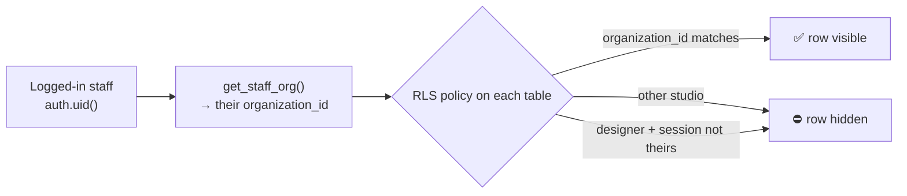
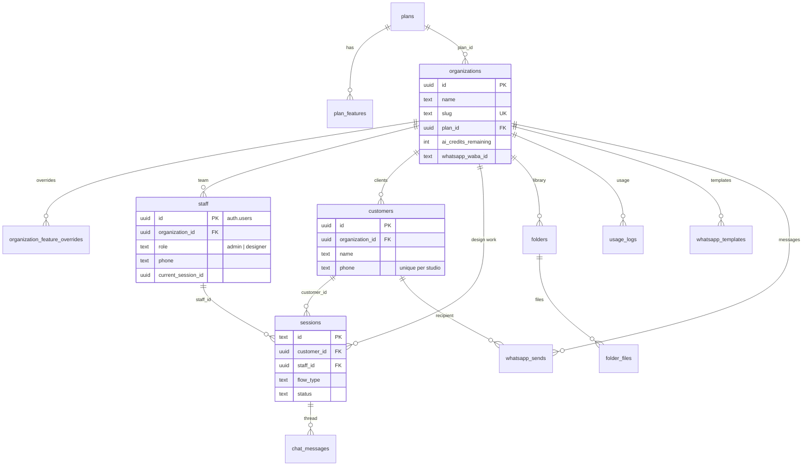
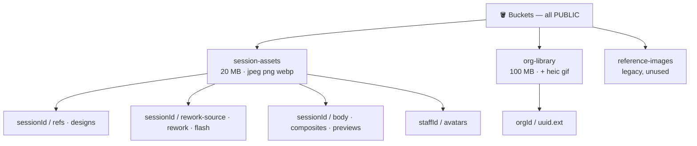
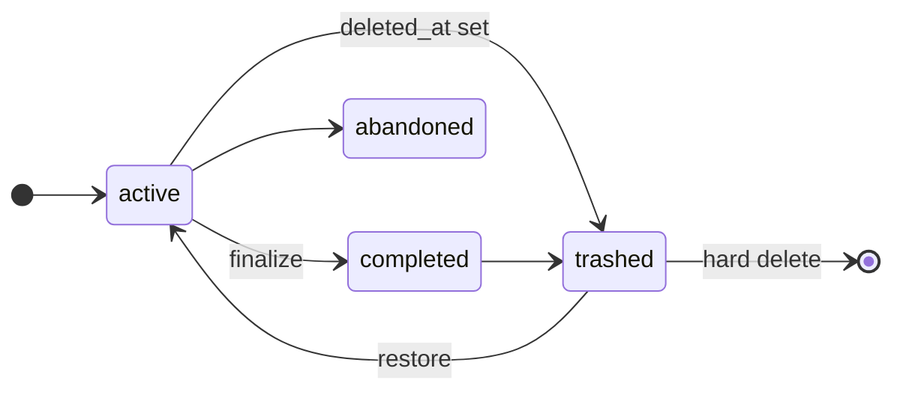
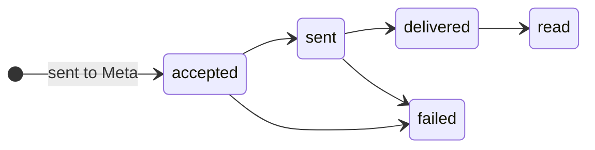

# 🗄️ Stenslee Studio — Database

> [!IMPORTANT]
> Supabase project `pmcunzmdftksnxswmzsi` is **production** and is shared with the super-admin app. Everything here is read from the live database (Oct 2026). `../../supabase-schema.sql` is an old snapshot — never trust or re-run it.

| | |
|---|---|
| 🧩 **Engine** | Postgres + Supabase Auth, Storage, Realtime, pg_cron |
| 🏢 **Tenancy** | Every studio row carries `organization_id`; RLS keeps studios apart |
| 📋 **Tables** | 16 tables · 2 views · 19 functions · 3 storage buckets |
| 🗑️ **Deleting** | Soft delete with `deleted_at` on `staff`, `sessions`, `folders`, `folder_files` — always filter `deleted_at is null` |

---

## Contents
1. [How tenancy works](#1-how-tenancy-works)
2. [Entity map](#2-entity-map)
3. [Tables](#3-tables)
4. [Who can access what](#4-who-can-access-what)
5. [Functions and triggers](#5-functions-and-triggers)
6. [Storage](#6-storage)
7. [Lifecycles](#7-lifecycles)
8. [Auth, Realtime, cron, extensions](#8-auth-realtime-cron-extensions)
9. [Changing the schema](#9-changing-the-schema)
10. [Known issues](#10-known-issues)

---

## 1. How tenancy works

- **One phone = one login = one studio.** `staff.id` is the `auth.users.id`; each staff row has one `organization_id`.
- **Roles:** `admin` sees the whole studio; `designer` sees only sessions/chat where `sessions.staff_id = auth.uid()`.
- **Super admins** pass `is_platform_admin()` and can see across studios (limited — see [§4](#4-who-can-access-what)).
- **Server routes** using the service role skip RLS and must check role + studio themselves.

---

## 2. Entity map

---

## 3. Tables

### 🏷️ Plans and platform

**`plans`** — subscription tiers. 🔒 super admins only (staff can't read → credits widget bug).

| Column | Type | Meaning |
|---|---|---|
| `name` | text | e.g. Starter |
| `price_cents` | int | 0 = free |
| `billing_interval` | text | `month` \| `year` |
| `is_active` | bool | offered or not |
| `ai_credits_included` | int | credits granted on create/switch |

**`plan_features`** — PK (`plan_id`, `feature_key`) → `enabled`, `limit_value`. 🔒 super admins only.

**`organization_feature_overrides`** — PK (`organization_id`, `feature_key`) → `enabled`, `limit_value`, `updated_by`. 🔒 studio admin reads own; super admins all.

**`platform_admins`** — super admins (`id` → auth.users, `email` unique, `name`, `is_active`). 🔒 super admins only.

### 🏢 Studio and team

**`organizations`** — a studio. 🔒 staff read own; super admins all.

| Column | Type | Meaning |
|---|---|---|
| `name`, `slug` | text | studio name; unique URL-safe id |
| `email` | text | contact email (format check) |
| `plan_id` | uuid | → `plans` (restrict delete) |
| `status` | text | `active` \| `suspended` \| `cancelled` (not enforced in studio) |
| `ai_credits_remaining` | int | ≥ 0, default 250 |
| `storage_used_bytes` | bigint | kept by a trigger |
| `whatsapp_waba_id`, `whatsapp_phone_number_id`, `whatsapp_display_phone_number` | text | connected WhatsApp |
| `whatsapp_access_token_enc` | text | **plain text for now**; older rows encrypted |
| `whatsapp_connected_at` | timestamptz | when connected |

**`staff`** — team members. 🔒 studio admin manages own studio; everyone reads self; super admins all. 📡 in Realtime.

| Column | Type | Meaning |
|---|---|---|
| `id` | uuid | = `auth.users.id` (cascade) |
| `role` | text | `admin` \| `designer` |
| `is_active` | bool | deactivated staff can't log in |
| `phone_country_code`, `phone_number`, `phone` | text | `phone` generated = code + number |
| `avatar_key` | text | `session-assets` path |
| `last_login_at` | timestamptz | 72 h timeout |
| `current_session_id` | uuid | the one allowed device |
| `trash_last_viewed_at`, `deleted_at` | timestamptz | trash badge; soft delete |

### 👥 Customers

**`customers`** — studio clients (never log in). 🔑 UNIQUE (`organization_id`, `phone`). ⚡ insert blocked unless phone verified in the last 15 min. 🔒 staff read/insert/update own studio; no delete path.

| Column | Type | Meaning |
|---|---|---|
| `name` | text | customer name |
| `phone_country_code`, `phone_number`, `phone` | text | `phone` generated |

**`customer_phone_verifications`** — 6-digit codes (plain text), `expires_at` 10 min, `verified_at`. 🔒 service role only. Never purged.

**`signup_requests`** — PK `phone` (digits) + `phone_country_code`, `phone_number`, `studio_name`, `name`, `email`. Valid 15 min, deleted on completion. 🔒 service role only.

### 🎨 Design work

**`sessions`** — one tattoo design job. 🔒 admin: whole studio · designer: own sessions · super admin: read.

| Column | Type | Meaning |
|---|---|---|
| `id` | text | created by the browser |
| `customer_id` | uuid | → customers (set null) |
| `staff_id` | uuid | → staff (set null) — "handled by"; null = Needs Attention |
| `flow_type` | text | `ai_design` \| `rework` |
| `rework_mode` | text | `cover` \| `extend` |
| `status` | text | `active` \| `completed` \| `abandoned` |
| `style`, `description`, `body_area` | text | design inputs |
| `selected_design_key`, `selected_design_style`, `flash_image_key` | text | chosen design + white-background version |
| `rework_source_photo_key` | text | photo of the existing tattoo |
| `placement_text`, `placement_body_photo_key`, `placement_composite_key` | text | placement preview |
| `completed_at`, `deleted_at` | timestamptz | finish; soft delete |

**`chat_messages`** — the design chat. `session_id` → sessions (cascade), `role` `user` \| `assistant`, `content`, `image_keys text[]` (storage keys or Pinterest URLs). 🔒 like sessions.

### 📁 Library

**`folders`** — tree (`parent_folder_id` → folders, cascade), `name`, `deleted_at`. ⚡ needs `design_library` on.
**`folder_files`** — `folder_id` (null = root), `file_name`, `storage_key`, `file_size_bytes`, `mime_type`, `deleted_at`. ⚡ size + quota check; keeps `storage_used_bytes` (trashed files still count).
🔒 both: studio admin own studio; super admins all.

### 📊 Usage and WhatsApp

**`usage_logs`** — append-only counter: `staff_id`, `session_id`, `feature_key`, `action`, `target_id`, `metadata jsonb`. Monthly limits count from here. 🔒 insert own studio; admins + super admins read.

**`whatsapp_templates`** — cache of Meta templates: `meta_template_id`, `name`, `category`, `language`, `status`, `components jsonb`. 🔑 UNIQUE (`organization_id`, `name`, `language`). 🔒 studio admin.

**`whatsapp_sends`** — one row per recipient: `customer_id`, `sent_by`, `template_name`, `to_phone`, `wamid`, `status`, `error_reason`, `sent_at`. No message bodies, nothing inbound. 🔒 studio admin.

### 👁️ Views

| View | Columns |
|---|---|
| `customer_session_stats` | `customer_id`, `session_count`, `last_session_at` |
| `designer_session_counts` | `staff_id`, `session_count` |

---

## 4. Who can access what

✅ full · 👁️ read · ✏️ read + write (no delete) · 🙋 own rows · — none

| Table | Studio admin | Designer | Super admin | Service role only |
|---|:---:|:---:|:---:|:---:|
| `organizations` | 👁️ own | 👁️ own | ✅ | |
| `plans`, `plan_features` | — | — | ✅ | |
| `organization_feature_overrides` | 👁️ own | — | ✅ | |
| `staff` | ✅ studio | 🙋 self | ✅ | |
| `customers` | ✏️ | ✏️ | ✅ | |
| `sessions`, `chat_messages` | ✅ studio | 🙋 own sessions | 👁️ sessions | |
| `folders`, `folder_files` | ✅ studio | — | ✅ | |
| `usage_logs` | 👁️ + insert | insert | 👁️ | |
| `whatsapp_templates`, `whatsapp_sends` | ✅ studio | — | — | |
| `customer_phone_verifications`, `signup_requests` | — | — | — | ✅ |

---

## 5. Functions and triggers

| Function | What it does | Security |
|---|---|---|
| `get_staff_org()` · `get_staff_role()` · `is_admin()` · `is_designer()` · `is_platform_admin()` | RLS helpers for the current user | DEFINER |
| `get_effective_access(org, key)` · `get_all_effective_access(org)` | plan + override − monthly usage → enabled, limit, used, remaining | DEFINER · any org id |
| `reserve_ai_credits(org, n)` · `refund_ai_credits(org, n)` | atomic credit reserve (10 / image) and refund | DEFINER |
| `claim_staff_session()` | saves the JWT `session_id` as the only device; stamps `last_login_at` | DEFINER |
| `auth_user_id_by_phone(phone)` | finds a login by phone digits | DEFINER · service role only |
| `search_customers(q)` | name / phone search | INVOKER (RLS) |
| `finalize_session(id)` | marks a session completed | DEFINER · ⚠️ no studio check |
| `folder_total_bytes(ids[])` | folder sizes | INVOKER |

| Trigger | Table | Effect |
|---|---|---|
| `customers_require_phone_verification` | customers | blocks insert without a verification < 15 min |
| `folders_require_design_library` | folders | blocks when `design_library` is off |
| `folder_files_enforce_limits` | folder_files | file size + storage quota |
| `folder_files_storage_sync` | folder_files | updates `organizations.storage_used_bytes` |
| `set_updated_at` | 12 tables | bumps `updated_at` |

---

## 6. Storage

| Bucket | Upload rule | Delete rule |
|---|---|---|
| `session-assets` | any admin or designer (⚠️ no studio check) | service role only |
| `org-library` | studio admin, own org folder, `design_library` on | studio admin own org · super admin |

---

## 7. Lifecycles

*Top: `sessions`. Bottom: `whatsapp_sends.status` (updated by the Meta webhook).*

---

## 8. Auth, Realtime, cron, extensions

| Item | Detail |
|---|---|
| 🔐 Staff login | phone + code via Send SMS hook → `/api/auth/send-whatsapp-otp` |
| 🔐 Super admin login | email + password |
| 📡 Realtime | publication includes `public.staff` only (single-device logout) |
| ⏰ pg_cron | `purge-expired-trash` daily 03:00 UTC — ⚠️ placeholder URL, sends POST to a GET route → no purge |
| 🧩 Extensions | pg_cron, pg_net, pgcrypto, uuid-ossp, supabase_vault, pg_stat_statements |

---

## 9. Changing the schema

1. Apply the SQL on the live project (SQL editor or migration) — it is production.
2. New `public` table → add `organization_id`, enable RLS, add policies for admin / designer / super admin.
3. Run Supabase advisors and fix new warnings.
4. Update this file, and [technical.md](technical.md) if behaviour changes.

---

## 10. Known issues

| Severity | Issue |
|---|---|
| 🔴 | All buckets public; `session-assets` upload doesn't check studio |
| 🔴 | `finalize_session` callable by anyone without studio check; `get_effective_access*` for any org |
| 🟠 | `get_staff_org()` ignores `is_active` / `deleted_at` (deactivated staff pass some RLS until login expires) |
| 🟠 | Purge cron broken (placeholder URL, POST vs GET, secret written in the job) |
| 🟡 | No purge for `customer_phone_verifications`, old `signup_requests`, `usage_logs`, `whatsapp_sends`; codes in plain text, no attempt limit |
| 🟡 | Staff can't read `plans` → credits widget total = remaining |
| 🟡 | Advisors: 16 functions with mutable `search_path`; DEFINER functions executable by `anon` / `authenticated` |
