# ⚙️ Stenslee Studio — Technical Guide

> [!NOTE]
> How the studio app is built and **why** it is built that way: the architecture, the core mechanisms, the decisions behind them, and recipes for extending it. Tables and database rules live in [database.md](database.md). Diagrams use Mermaid (GitHub renders them; in VS Code install *Markdown Preview Mermaid Support*).

| | |
|---|---|
| 🧱 **Stack** | Next.js 16.2 (App Router) · React 19 · TypeScript strict · Tailwind v4 · Zustand |
| 🗄️ **Backend** | Supabase — Postgres + RLS, Auth, Storage, Realtime, pg_cron (shared with super-admin, **production**) |
| 🤖 **AI** | KIE.ai (`gpt-image-2-image-to-image`, `nano-banana-pro`) · OpenAI `gpt-4o-mini` |
| 💬 **Messaging** | Meta WhatsApp Cloud API (login codes + studio templates) |
| 🌐 **Hosting** | Vercel — `dashboard.stenslee.com` |
| 🧪 **Tests** | None — type check, lint, build, browser |

---

## Contents
1. [Architecture](#1-architecture)
2. [Life of a request](#2-life-of-a-request)
3. [Identity: login, signup, one device](#3-identity-login-signup-one-device)
4. [Security model and multi-tenancy](#4-security-model-and-multi-tenancy)
5. [Talking to the database](#5-talking-to-the-database)
6. [Plans, permissions and credits](#6-plans-permissions-and-credits)
7. [The AI generation engine](#7-the-ai-generation-engine)
8. [Design session state](#8-design-session-state)
9. [Images and storage](#9-images-and-storage)
10. [WhatsApp integration](#10-whatsapp-integration)
11. [Deletion and retention](#11-deletion-and-retention)
12. [Conventions and why they exist](#12-conventions-and-why-they-exist)
13. [Recipes](#13-recipes)
14. [Configuration](#14-configuration)
15. [Local development](#15-local-development)
16. [Going to production](#16-going-to-production)
17. [Known issues and tech debt](#17-known-issues-and-tech-debt)
18. [Where things live](#18-where-things-live)

---

## 1. Architecture

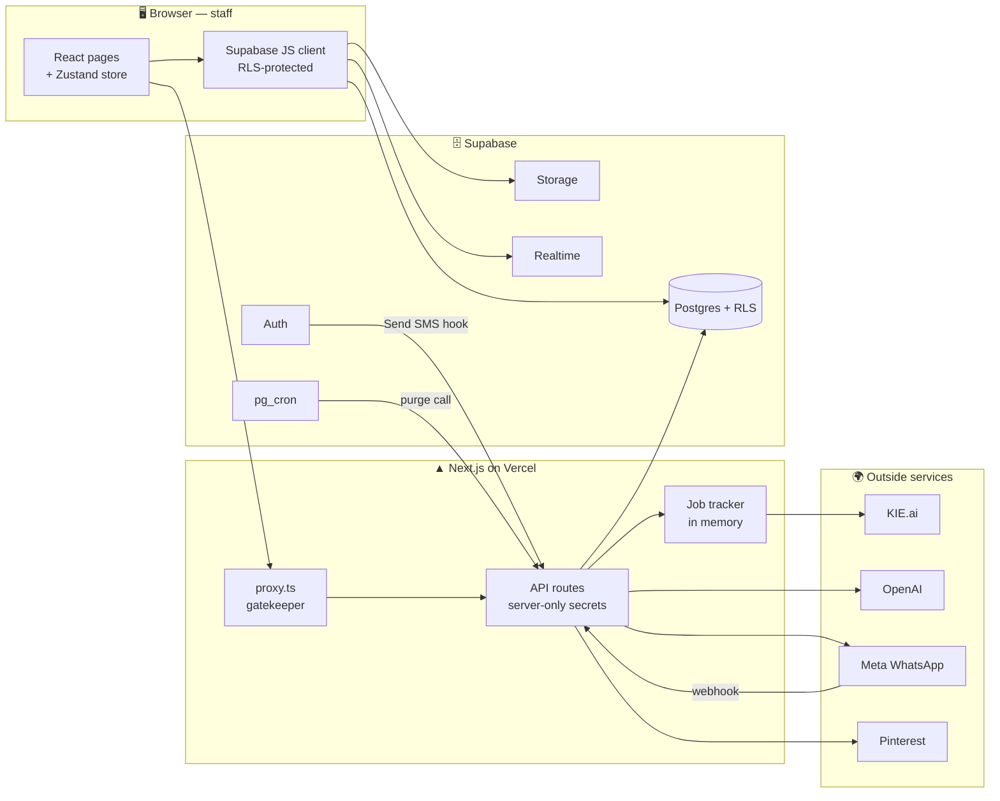

The app has **three kinds of code**, and each has a clear job:

| Layer | Runs where | Job | Trust level |
|---|---|---|---|
| **Pages & components** (`src/app`, `src/features`, `src/components`) | Browser | UI, most reads and simple writes through the Supabase client | Untrusted — the database rules protect data |
| **API routes** (`src/app/api`) | Vercel server | Anything that needs a secret: AI providers, Meta, service-role database work, signature checks | Trusted — must check who is calling |
| **Database rules** (RLS, functions, triggers) | Postgres | Keep studios apart, enforce roles, verify phones, enforce limits | Final authority |

> [!TIP]
> When deciding where new logic goes, ask: *does it need a secret or must it bypass RLS?* If yes → API route. If no → browser + RLS.

---

## 2. Life of a request

Every page request passes through `src/proxy.ts` (Next.js 16 calls middleware "proxy"; it must stay in `src/`).

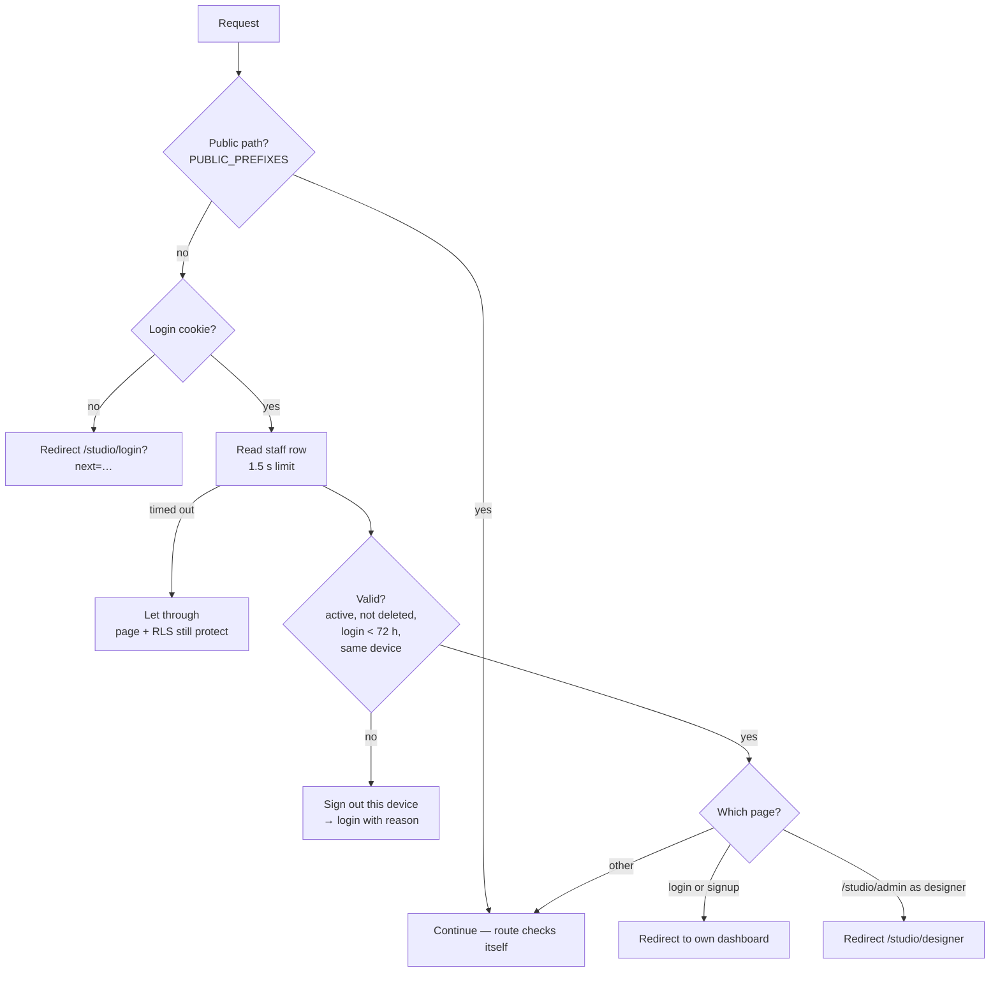

| Outcome | Reason shown on login page |
|---|---|
| Staff deactivated or removed | `access_denied` — "Your account has been deactivated…" |
| Last login older than 72 h | `session_expired` |
| Same account logged in elsewhere | `signed_in_elsewhere` |

**Why read the session from the cookie, not the network?** `getSession()` decodes the JWT locally. A network call on every request was slow and, on machines where `supabase.co` is blocked, failed and bounced users in a loop. The staff lookup is capped at 1.5 s and fails *open*, because RLS still protects the data.

**Public paths** (no login check in the proxy): the login-code hook, signup APIs, the WhatsApp webhook, AI job routes and image helpers. AI routes check features themselves; a few image helpers check nothing (see [§17](#17-known-issues-and-tech-debt)).

---

## 3. Identity: login, signup, one device

### 3.1 Login with a WhatsApp code

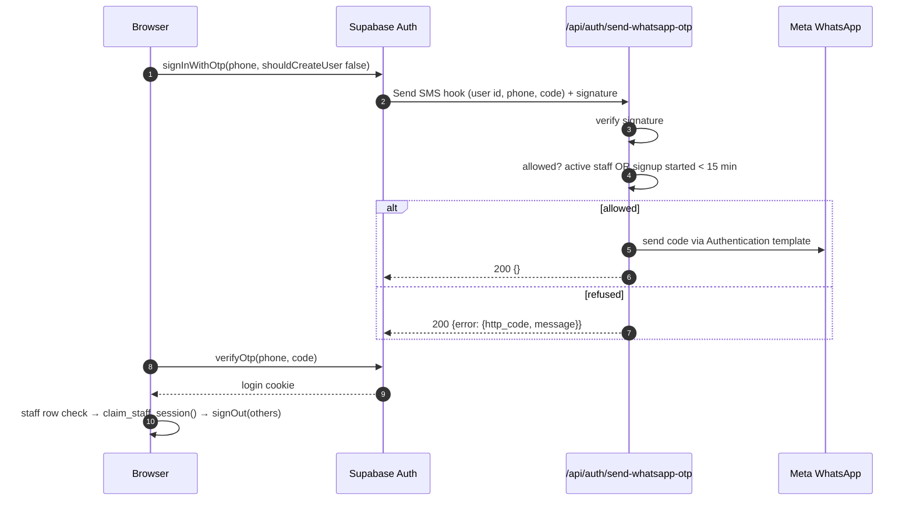

**Design decisions**

| Decision | Why |
|---|---|
| Codes go over **WhatsApp**, not SMS | Studios and customers already live on WhatsApp; Supabase's hook lets us replace the SMS provider |
| Hook refuses with **HTTP 200** + error body | Supabase only passes the message to the user that way; 4xx becomes a generic error |
| `shouldCreateUser: false` on login | Unknown numbers can't create accounts; they get `otp_disabled` → "isn't registered" |
| Hook must answer in **< 5 s** | Supabase's limit. Dev pre-compiles the route (`instrumentation.ts`) and keeps it warm (`onDemandEntries`) |
| One hook per Supabase project | Production URL must stay `https://dashboard.stenslee.com/api/auth/send-whatsapp-otp` |

### 3.2 One device at a time

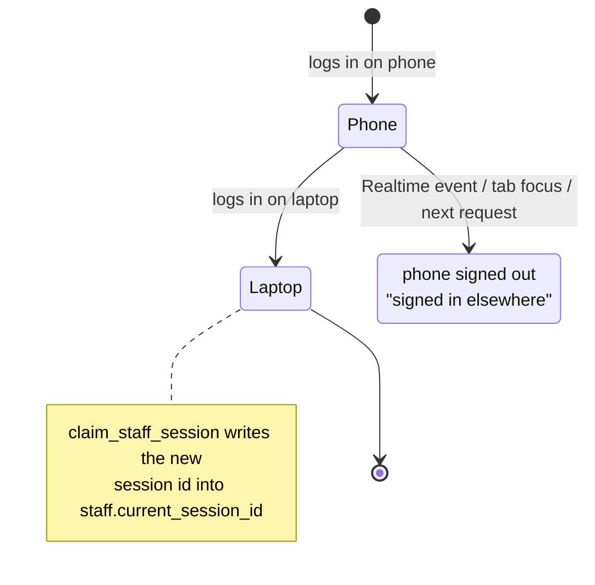

Three things enforce it: `signOut({scope:"others"})` right after login, `SingleSessionGuard` (Realtime on the user's own `staff` row + a check when the tab regains focus), and `proxy.ts` comparing the JWT `session_id` with `staff.current_session_id`.

### 3.3 Self-serve signup

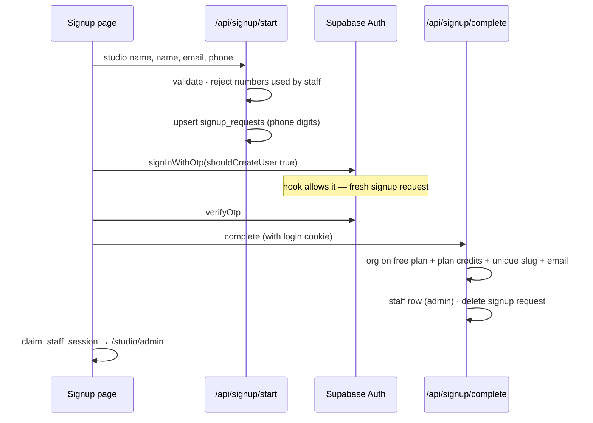

**Phone identity rule:** `staff.id` = auth user id, and a staff row has one `organization_id`. So **one phone = one studio**. Customers are different — unique per studio, so the same phone can be a customer in many studios.

---

## 4. Security model and multi-tenancy

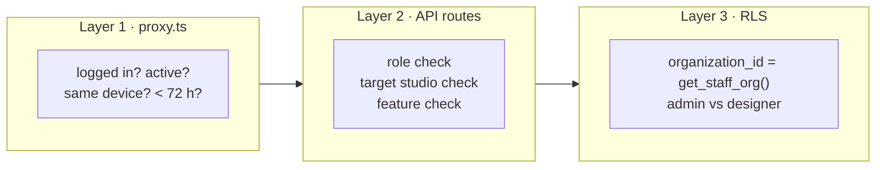

- **Tenancy key:** every studio row has `organization_id`. RLS policies compare it with `get_staff_org()`. Designers are further limited to sessions where `staff_id = auth.uid()`.
- **Service role** (`createServiceClient()`) bypasses RLS. It is only allowed in server files, and the route must check the caller's **role** and that the **target belongs to the caller's studio**.
- **Signed inbound calls:** Supabase hook → Standard Webhooks HMAC (`SEND_SMS_HOOK_SECRET`); Meta webhook → `x-hub-signature-256` HMAC (`META_APP_SECRET`); cron → `CRON_SECRET`.
- **Secrets never reach the browser:** only `NEXT_PUBLIC_*` variables are public.

> [!WARNING]
> Known gaps: some admin routes don't check the target's studio, a few helper routes have no auth, and all storage buckets are public. See [§17](#17-known-issues-and-tech-debt).

---

## 5. Talking to the database

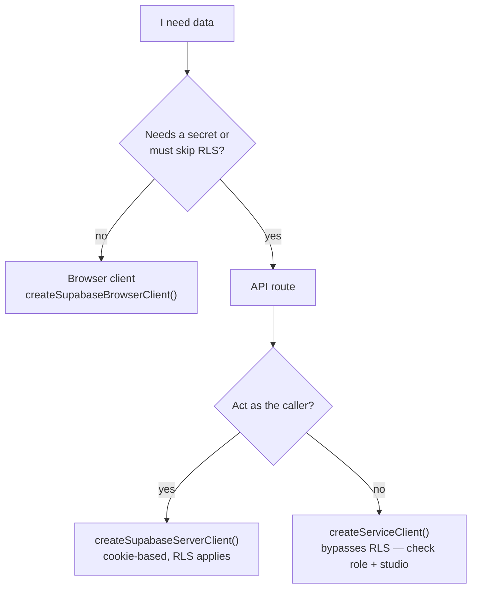

| Client | File | Use for |
|---|---|---|
| Browser | `lib/supabase-client.ts` | Lists, dashboard numbers, edits RLS allows |
| Server (cookie) | `lib/supabase-server.ts` → `createSupabaseServerClient` | Finding out who is calling |
| Service role | `lib/supabase-server.ts` → `createServiceClient` | Auth admin, credits, signup, storage deletes, WhatsApp tokens |

**Phone formats:** `staff.phone` / `customers.phone` = `+<code><number>` (generated column); Supabase `auth.users.phone` = digits only. Country codes up to 4 digits (e.g. `+1876`), full number ≤ 15 digits (`lib/phone.ts`). Every phone field uses `<PhoneInput>` (country picker from `countries-list`).

**Adding a team member** (`lib/staff-phone.ts`):

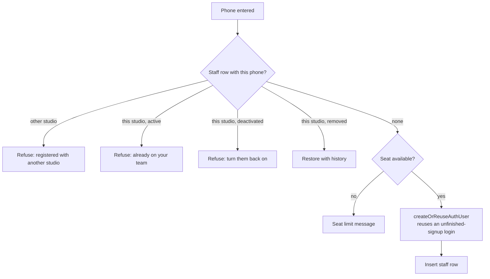

---

## 6. Plans, permissions and credits

### 6.1 How "is this feature on?" is decided

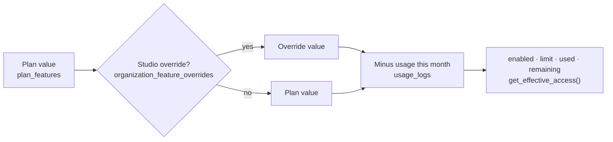

- **Server:** `requireFeature(key)` / `checkFeature()` / `requireSeatAvailable(role)` in `lib/permissions/require-feature.ts` (with retry). Usage is recorded with `permissions/log-usage.ts`.
- **Browser:** `PermissionBootstrap` loads everything once (`get_all_effective_access`); `use-feature.ts` reads it; `<FeatureLocked>` shows the locked state.
- Keys are defined in `lib/permissions/feature-keys.ts` and **must be mirrored** in `super-admin/src/lib/feature-registry.ts`.

| Key | Starter | Key | Starter |
|---|---|---|---|
| `ai_design` | 150 / month | `designer_seats` | 10 |
| `enhance_prompt` | 100 / month | `admin_seats` | 3 |
| `placement` | 100 / month | `storage_quota` | 500 MB |
| `pinterest_search` | 50 / month | `library_file_size_limit` | 50 MB |
| `trash_retention` | 30 days | `catalog` | off (not built) |

On/off only (all on in Starter): `customer_management`, `upload_existing`, `browse_previous`, `rework`, `text_tattoo`, `flash_isolate`, `camera_capture`, `print_stencil`, `admin_dashboard`, `design_library`, `whatsapp`.

### 6.2 AI credits

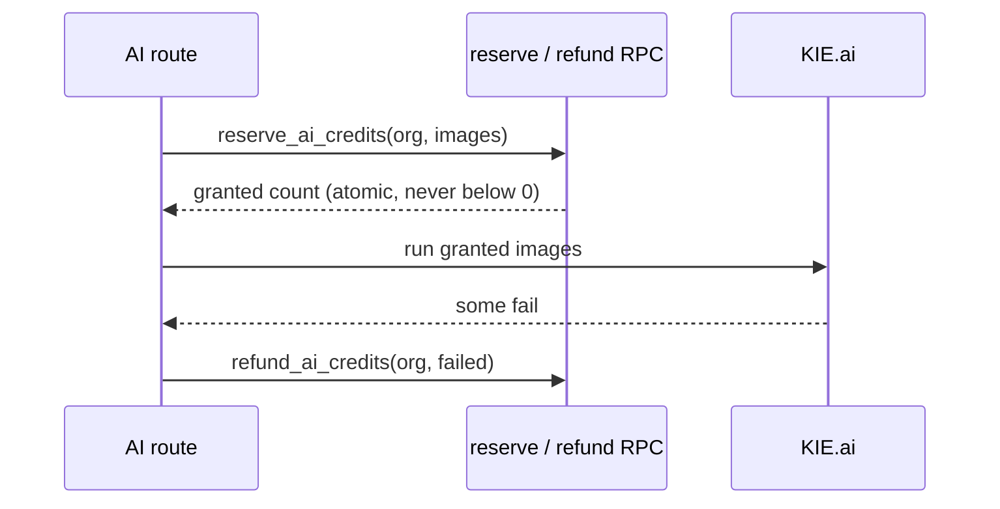

- `CREDITS_PER_IMAGE = 10` (`lib/credits.ts`). Starter grants 250 once — **no automatic refill**; super admins top up or switch plan (switching sets credits to the plan's amount).
- **Upgrade paths:** `AccountMenu` → "Upgrade plan", the mobile "Upgrade" button, and `UpgradeBanner` at 0 credits — all open `wa.me/919849884501` with the studio name (`lib/upgrade.ts`). `AdminSidebarShell` re-reads credits on every navigation.

---

## 7. The AI generation engine

### 7.1 Start a job, then poll

Generations take 1–2 minutes, longer than is safe to hold one request open. So a POST **starts** a job and returns immediately; the browser **polls**.

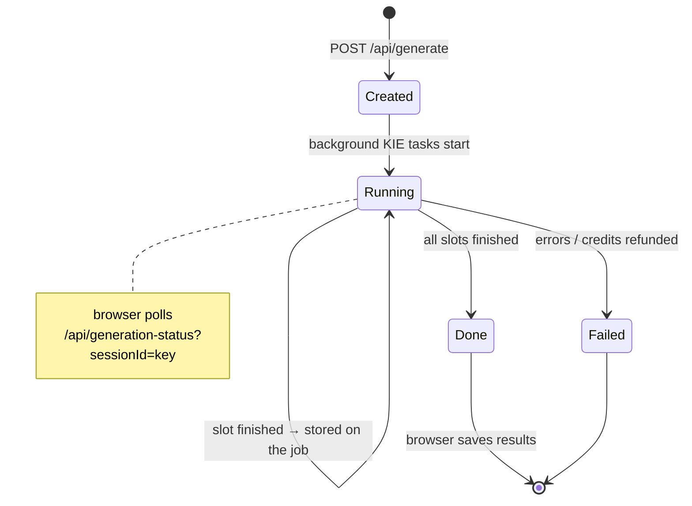

- Jobs live in an in-memory `Map` on `globalThis` (`lib/generation-jobs.ts`), TTL 15 min. A page reload resumes polling the same job.
- KIE calls: `createKeiTask` → `waitForKeiTask` (`lib/kei-api.ts`). Results come back as KIE URLs, downloaded and stored in `session-assets`.

> [!IMPORTANT]
> The in-memory tracker assumes **one long-running server process**. Serverless scale-out or a restart loses running jobs. Moving jobs to the database is the fix if this becomes a problem.

### 7.2 Models and prompts

| Mode | Route | Model | Prompt source |
|---|---|---|---|
| AI Design + refine | `/api/generate` | `gpt-image-2-image-to-image` | `features/ai-design/prompts.ts` → `buildTattooPrompt()` (70+ style descriptors) |
| Text Tattoo | `/api/generate` (`isTextTattoo`) | `nano-banana-pro` | same |
| Rework (cover / extend) | `/api/generate-rework` | `gpt-image-2-image-to-image` | `features/rework/prompts.ts` |
| Flash (white background) | `/api/generate-flash` | `gpt-image-2-image-to-image` | `FLASH_PROMPT` in route |
| Placement preview | `/api/placement` | `gpt-image-2-image-to-image` (was nano-banana-pro) | `features/placement/prompts.ts` |
| Enhance description | `/api/enhance-prompt` | OpenAI `gpt-4o-mini` | in route |

**Lessons baked into the code**
- **Short prompts win.** Long ALL-CAPS rule lists made image edits less faithful. Shorten before adding rules.
- **Rotate references.** `rotateReferences()` changes which reference leads each of the 5 slots; otherwise the model copies reference #1 five times.
- `faithfulMode` = "minor changes only" refinement.
- Pinterest search uses Pinterest's internal `BaseSearchResource` endpoint (unofficial). Chosen pins are proxied and re-uploaded to `refs` before KIE sees them.

---

## 8. Design session state

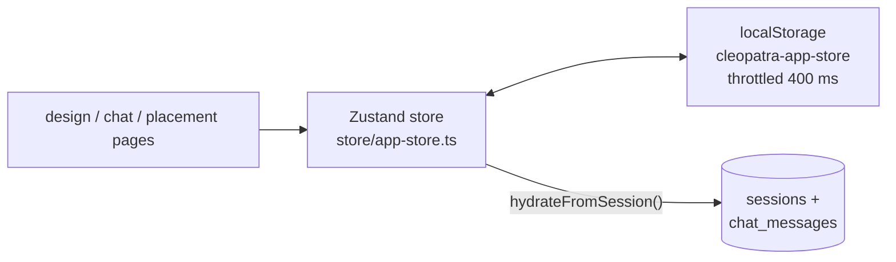

- Pages render instantly from the store, then sync from the database in the background.
- The store is ahead of the database during typing, so a page skips hydration when the store already holds that session.

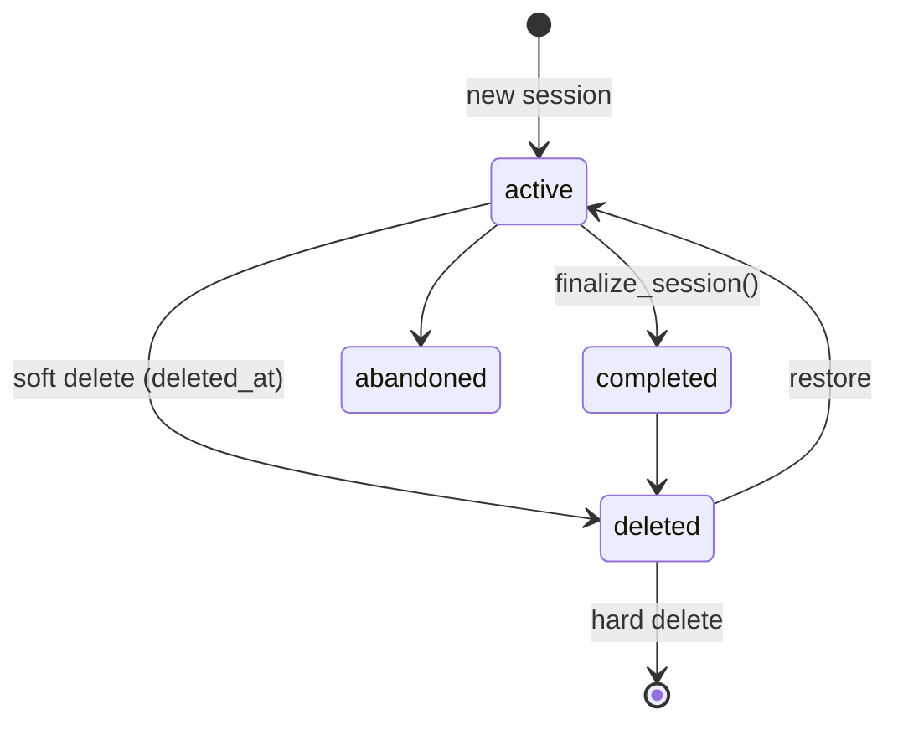

> [!WARNING]
> The store is not cleared on logout, so a customer's name and phone stay in that browser's localStorage.

---

## 9. Images and storage

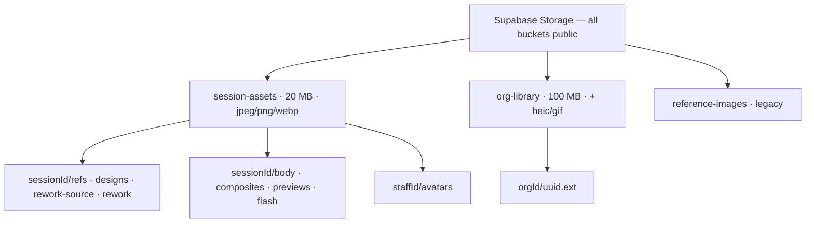

| Concern | Approach |
|---|---|
| Uploading | Browser first (`lib/browser-upload.ts`, retry with backoff); server upload (`lib/storage.ts`) when needed |
| Showing images | `lib/image-src.ts` loads own-storage URLs directly, others through `/api/proxy-image` |
| Library quota | Triggers keep `organizations.storage_used_bytes` and enforce file size + quota |
| Deleting | Only via service role: `lib/session-storage-cleanup.ts` (sessions), library routes |
| Stencils | `features/print-stencil` — jsPDF, mirrored, multi-page A4, safe-area guide |

---

## 10. WhatsApp integration

### 10.1 Two numbers, two jobs

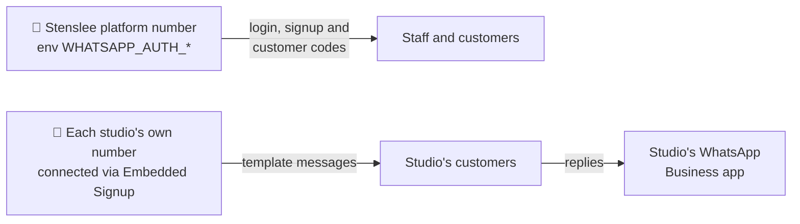

### 10.2 Connecting a studio (Embedded Signup, Coexistence)

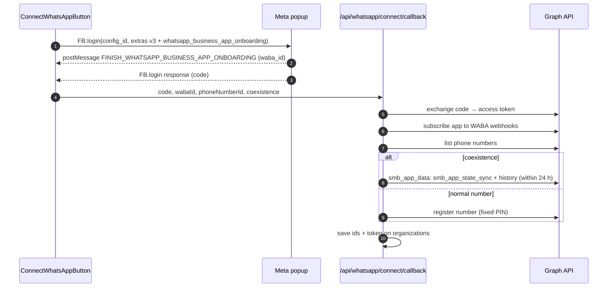

- The browser waits for **both** halves (code + finish event), in either order.
- **Token storage:** currently **plain text** in `whatsapp_access_token_enc` (temporary). `lib/whatsapp/org-config.ts` still decrypts older AES-256-GCM rows (`crypto.ts`, `WHATSAPP_TOKEN_ENCRYPTION_KEY`).
- Temporary debug logs: `[whatsapp-connect]` (button + callback) and `[graph]` (`graph.ts`, token masked).

### 10.3 After connecting

| Piece | How it works |
|---|---|
| Templates | Created/deleted on Meta, cached in `whatsapp_templates` |
| Sending | `/api/whatsapp/send` → one `whatsapp_sends` row per recipient |
| Delivery status | Meta webhook → only `messages.statuses` update `whatsapp_sends`; replies, history, echoes are acknowledged and dropped |

### 10.4 Meta requirements

- [ ] Meta app "Stenlee" `2314246366065872` (business "Repealtess").
- [ ] JS SDK allowed domain + OAuth redirect `https://dashboard.stenslee.com/studio/admin/whatsapp`.
- [ ] Webhook `https://dashboard.stenslee.com/api/whatsapp/webhook`, fields `messages`, `history`, `smb_app_state_sync`, `smb_message_echoes`. **One URL per app** → no local webhooks.
- [ ] App Review approved (Advanced Access to `whatsapp_business_management` + `whatsapp_business_messaging`), business verification, Tech Provider. Until then only +1 555 test numbers (≤ 5 recipients); real Business-app numbers show "Ineligible" / error #2655111.

---

## 11. Deletion and retention

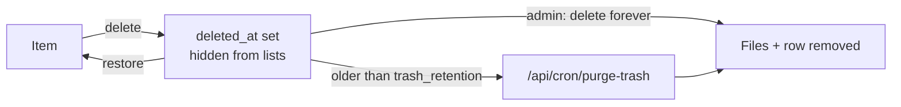

- Applies to sessions, library files/folders; staff are soft-deleted and kept (history keeps their name).
- Hard delete: `/api/studio/trash/[id]` + `lib/session-storage-cleanup.ts`.
- ⚠️ The pg_cron job is broken (placeholder URL, POST vs GET), so nothing is purged automatically. Cleanup also misses `rework`, `rework-source`, `flash` files.

---

## 12. Conventions and why they exist

| Rule | Why |
|---|---|
| Comments: one short line, two max | Clean, scannable code |
| Read `node_modules/next/dist/docs/` before unfamiliar Next APIs | Next 16 changed many conventions |
| Soft delete + filter `deleted_at is null` | Mistakes are recoverable; history stays correct |
| Long AI work = job + poll | No minute-long requests |
| Reserve credits first, refund failures | Credits never lost or negative |
| Browser client by default | RLS protects data automatically |
| Service role only server-side, with role + studio checks | It bypasses RLS |
| No native `<select>`; phones via `<PhoneInput>` | Consistent UI, one validation path |
| Feature keys mirrored in super-admin | Super-admin grids must list every key |
| Hook refusals = 200 + error body | Supabase shows the message only that way |
| `{" "}` after a tag followed by text with `&rsquo;` | SWC trims that space otherwise |

---

## 13. Recipes

**🧩 Add an API route**
1. Create `src/app/api/<name>/route.ts`.
2. Identify the caller with `createSupabaseServerClient()`; check role.
3. Gate with `requireFeature(key)` if it belongs to a plan feature.
4. Use the service role only if needed — then check the target's `organization_id`.
5. If it must skip the proxy login check, add it to `PUBLIC_PREFIXES` (rare) and authenticate inside.

**🎛️ Add a feature key**
1. Add it to `lib/permissions/feature-keys.ts` (and to the limit list if it has a number).
2. Mirror it in `super-admin/src/lib/feature-registry.ts`.
3. Insert `plan_features` rows for existing plans.
4. Gate server routes with `requireFeature`, UI with `use-feature` / `<FeatureLocked>`; log usage if it is counted monthly.

**🗃️ Add a table**
1. Create it on the live project with `organization_id` + RLS (admin/designer/platform-admin policies as needed).
2. Run Supabase advisors.
3. Document it in [database.md](database.md).

**⏳ Add a long-running AI action**
1. POST route creates a job in `generation-jobs.ts`, reserves credits, starts work in the background, returns.
2. Reuse `/api/generation-status` for polling.
3. Refund credits for failed images; log usage.

---

## 14. Configuration

| Group | Variables |
|---|---|
| Supabase | `NEXT_PUBLIC_SUPABASE_URL`, `NEXT_PUBLIC_SUPABASE_ANON_KEY`, `SUPABASE_SERVICE_ROLE_KEY` |
| AI | `KEI_API_KEY`, `OPENAI_API_KEY` |
| Login codes | `SEND_SMS_HOOK_SECRET`, `WHATSAPP_AUTH_PHONE_NUMBER_ID`, `WHATSAPP_AUTH_ACCESS_TOKEN`, `WHATSAPP_AUTH_TEMPLATE_NAME`, `WHATSAPP_AUTH_TEMPLATE_LANGUAGE` |
| Studio WhatsApp | `NEXT_PUBLIC_META_APP_ID`, `META_APP_SECRET`, `NEXT_PUBLIC_META_EMBEDDED_SIGNUP_CONFIG_ID`, `META_WEBHOOK_VERIFY_TOKEN`, `META_GRAPH_API_VERSION`, `WHATSAPP_TOKEN_ENCRYPTION_KEY` |
| Jobs | `CRON_SECRET` |
| Unused | `PINTEREST_APP_ID`, `PINTEREST_APP_SECRET`, `ADMIN_EMAIL`, `ADMIN_PASSWORD` |

`next.config.ts`: `onDemandEntries` keeps compiled routes for 24 h (hook timing).

---

## 15. Local development

```bash
npm install
npm run dev                 # http://localhost:3000
npx tsc --noEmit -p .       # type check
npx eslint <changed files>  # lint
npx next build              # stop the dev server first
```

| Situation | What to know |
|---|---|
| Logging in locally | The Supabase hook is shared with production. Leave it on production (codes still arrive) or point it at ngrok briefly and switch back |
| `ECONNRESET` / `check_failed` from server code | ISP DNS blocks `supabase.co` → enable DNS over HTTPS in Windows |
| "Another next dev server is already running" | A background `node.exe` is alive — stop it by port/PID |
| "Could not find the module … Client Manifest" | Two servers or a build shared `.next` — stop all, delete `.next` |
| WhatsApp delivery statuses | Only reach production (one webhook URL) |

Check UI changes at 390 px width as well as desktop.

---

## 16. Going to production

- [ ] All env vars set on Vercel.
- [ ] Supabase Send SMS hook → `https://dashboard.stenslee.com/api/auth/send-whatsapp-otp`, secret = production `SEND_SMS_HOOK_SECRET`.
- [ ] Supabase Auth SMS rate limit raised above 30/hour before open signups.
- [ ] Meta: allowed domain, OAuth redirect, production webhook.
- [ ] pg_cron `purge-expired-trash`: real URL, GET, current `CRON_SECRET`.

---

## 17. Known issues and tech debt

| Severity | Issue | Where |
|---|---|---|
| 🔴 High | All storage buckets public (body photos readable by URL) | Storage |
| 🔴 High | No auth on `upload-ref`, `generation-status`, `proxy-image`, `pinterest/image` | API |
| 🔴 High | `finalize_session` callable by anyone without studio check | DB function |
| 🟠 Medium | Admin routes without target-studio check: `PATCH/DELETE studio/designers`, `PATCH studio/profile`, `DELETE studio/trash/[id]` | API |
| 🟠 Medium | WhatsApp token stored in plain text (temporary); Privacy Policy still says encrypted | WhatsApp |
| 🟠 Medium | Trash purge never runs; cleanup misses rework/flash files | Retention |
| 🟠 Medium | In-memory AI jobs break with multiple instances | AI engine |
| 🟡 Low | Customer name/phone left in localStorage after logout | Store |
| 🟡 Low | No customer delete; phone edits not re-verified | Customers |
| 🟡 Low | No WhatsApp opt-in/opt-out tracking | WhatsApp |
| 🟡 Low | Org `status` not enforced; credits widget total wrong (staff can't read `plans`) | Plans |

---

## 18. Where things live

| Area | Paths |
|---|---|
| Gatekeeping | `src/proxy.ts`, `components/session/SingleSessionGuard.tsx`, `components/layout/AdminSidebarShell.tsx` |
| Pages | `app/(staff)/studio/{login,signup,designer,admin/*,sessions/[id]}`, `app/(staff)/customer/[userId]`, `app/[sessionId]/{design,chat,placement}` |
| Features | `features/{ai-design,rework,placement,text-tattoo,pinterest-search,camera-capture,browse-previous,flash-isolate,print-stencil,customer-management,admin-dashboard,whatsapp}` |
| Core libs | `lib/{kei-api,generation-jobs,credits,permissions/*,whatsapp/*,phone,signup,staff-phone,session-id,storage,browser-upload,image-src,library-storage,session-storage-cleanup,upgrade}.ts` |
| State | `store/app-store.ts` |
| Shared UI | `components/ui/{Button,PhoneInput,OtpInput,StyleSelect,FilterChips,FeatureLocked,ConfirmDialog}.tsx` |
